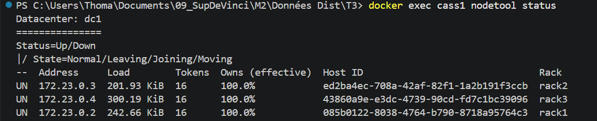
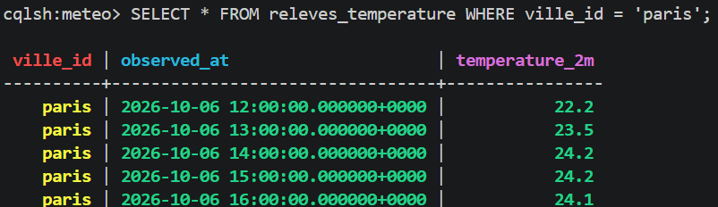
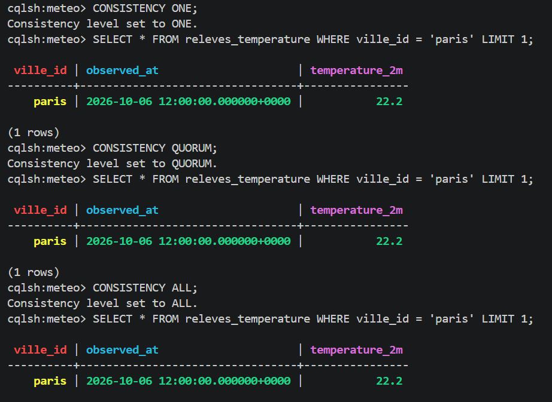

# Compte-rendu : cluster Cassandra, réplication et panne d'un nœud

> Le détail des réponses aux questions du TP se trouve dans le fichier `réponse_tp.pdf`.

Sujet : relevés horaires de température pour Paris (API Open-Meteo).

## 1. Architecture du cluster

Le cluster `tp2-cluster` est composé de 3 nœuds Cassandra 4.1 lancés avec Docker Compose, dans un seul datacenter `dc1`, avec un nœud par rack.

```
Cluster tp2-cluster
        │
       dc1
 ┌──────┼──────┐
rack1  rack2  rack3
 │      │      │
cass1  cass2  cass3
```

| Niveau | Nom | Rôle |
|---|---|---|
| Cluster | `tp2-cluster` | ensemble des nœuds |
| Datacenter | `dc1` | regroupe les nœuds, le RF se règle ici |
| Rack | `rack1`, `rack2`, `rack3` | zone de panne : les copies sont réparties sur des racks différents |
| Node | `cass1`, `cass2`, `cass3` | stocke les données et répond aux requêtes |

- Les nœuds sont égaux (pas de nœud principal) et démarrés progressivement : `cass1`, puis `cass2`, puis `cass3`.
- `cass1` est le seed et le seul à exposer le port 9042.
- Chaque nœud possède 16 tokens (48 sur l'anneau).



## 2. Table métier du TP2

Keyspace `meteo`, table `releves_temperature` :

| Colonne | Type | Rôle |
|---|---|---|
| `ville_id` | text | clé de partition |
| `observed_at` | timestamp | clé de clustering |
| `temperature_2m` | double | température en °C à 2 m |

La table contient 20 relevés horaires pour Paris. Le keyspace contient aussi une table `villes` (clé `ville_id`) avec le nom et les coordonnées de la ville.



## 3. Replication Factor

```sql
CREATE KEYSPACE meteo
WITH replication = {'class': 'NetworkTopologyStrategy', 'dc1': 3};
```

RF = 3 signifie que chaque partition est copiée 3 fois. Comme il y a 3 nœuds, chacun possède une copie de toutes les données (`Owns (effective)` = 100 % partout). La partition `paris` est donc présente sur `cass1`, `cass2` et `cass3`.

Chemin d'une donnée : partition key (`ville_id`) → hash → token → nœud responsable → réplicas.


## 4. Tests de cohérence ONE, QUORUM, ALL

Le niveau de cohérence indique combien de réplicas doivent répondre pour que la requête réussisse. Avec RF = 3 :

| Niveau | Réplicas exigés |
|---|---|
| `ONE` | 1 |
| `QUORUM` | 2 (RF/2 + 1) |
| `ALL` | 3 |

Requêtes exécutées sur une donnée réelle de la table, avec les 3 nœuds en marche :

```sql
CONSISTENCY ONE;
SELECT * FROM releves_temperature WHERE ville_id = 'paris' AND observed_at = '<observed_at>';

CONSISTENCY QUORUM;
SELECT * FROM releves_temperature WHERE ville_id = 'paris' AND observed_at = '<observed_at>';

CONSISTENCY ALL;
SELECT * FROM releves_temperature WHERE ville_id = 'paris' AND observed_at = '<observed_at>';
```

Avec les 3 nœuds disponibles, les trois lectures réussissent et renvoient la même ligne.



## 5. Simulation de panne

```bash
docker stop cass3
docker exec cass1 nodetool status
```

`cass3` passe en `DN` (Down, Normal), `cass1` et `cass2` restent en `UN`. Il reste 2 réplicas sur 3.


Résultats des lectures pendant la panne :

| Niveau | Réplicas exigés | Réplicas disponibles | Résultat |
|---|---|---|---|
| `ONE` | 1 | 2 | fonctionne |
| `QUORUM` | 2 | 2 | fonctionne |
| `ALL` | 3 | 2 | échoue (`Unavailable`) |

Pendant la panne, j'ai aussi inséré un relevé de test en `QUORUM`, et l'écriture a réussi :

```sql
CONSISTENCY QUORUM;
INSERT INTO releves_temperature (ville_id, observed_at, temperature_2m)
VALUES ('paris', '2026-10-20 12:00:00', 99.9);
```


## 6. Redémarrage de cass3

```bash
docker start cass3
docker exec cass1 nodetool status
```

Après quelques secondes, `cass3` repasse en `UN`.


Vérification des données depuis `cass3` :

```sql
CONSISTENCY ONE;
SELECT * FROM releves_temperature
WHERE ville_id = 'paris' AND observed_at = '2026-10-20 12:00:00';
```

Le relevé inséré pendant la panne est présent sur `cass3` : les autres nœuds l'ont gardé de côté (*hinted handoff*) et retransmis à son retour.


## 7. Observations et conclusions

**Scénario :** 3 nœuds → RF = 3 → données répliquées → arrêt de `cass3` → 2 nœuds disponibles → tests `ONE` / `QUORUM` / `ALL` → redémarrage de `cass3` → retour du nœud → vérification des données.

**Observations :**
- Avec un nœud en panne, `ONE` et `QUORUM` fonctionnent, `ALL` échoue : la requête réussit seulement si le nombre de réplicas disponibles est supérieur ou égal au nombre de réplicas exigés par le niveau.
- L'écriture faite pendant la panne n'a pas été perdue : `cass3` l'a récupérée en revenant.

**Pourquoi la réplication permet de continuer à fonctionner :** chaque donnée existe en plusieurs exemplaires sur des nœuds différents. Quand `cass3` tombe, les deux autres nœuds ont encore une copie complète de toutes les partitions, et comme il n'y a pas de nœud principal à remplacer, n'importe quel nœud peut répondre.

**Compromis :** plus le niveau de cohérence exige de réplicas, plus la donnée lue est fiable, mais moins le cluster tolère de pannes. `QUORUM` offre un bon équilibre : il garantit la lecture de la dernière écriture quand on lit et écrit en `QUORUM` (2 + 2 > 3), et il supporte la panne d'un nœud.
